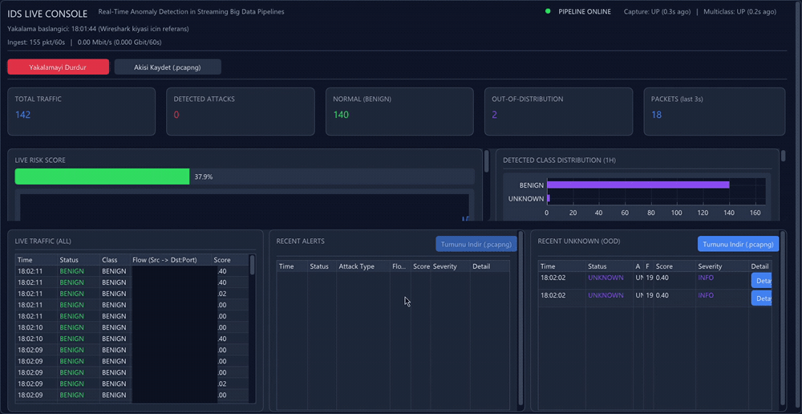

# Live IDS Console

A real-time network intrusion detection console for Windows. A single native
`ids_dashboard.exe` starts the whole pipeline — live packet capture, a streaming
multiclass detector, and a SOC-style dashboard — from one program, with no Kafka,
no web server, and no manual setup between parts.



*Live capture on the left, the committee's verdict on the right: an ESP32 port scan against the lab machine takes the risk score from green to ~96% and fills the alert feed in seconds (source IP column redacted).*

This is the **live/serving** side of the project. The models it runs, and all the
training and evaluation behind them, live in the companion repository:
[**IDS-Multiclass-Training**](https://github.com/BurakCANKURT/IDS-Multiclass-Training).

This started as my bachelor's thesis. The training repo answers *"can the models
detect attacks they have never seen?"*; this project began with the next question —
out of today's real traffic and real attacks, how much can that model actually catch?

Building it taught me things I had only read about before: how newer technologies —
new protocols and new ways of moving data — behave differently from the old ones and
leave a different footprint on the wire. A clear example is QUIC, the modern transport
that is replacing the classic TCP+TLS stack: it runs as high-rate UDP, and because the
models were trained on older, pre-QUIC traffic they do not recognize it — the
out-of-distribution gate flags it as UNKNOWN rather than forcing it into a benign or
attack label, which is exactly the safe behavior it was designed for.

Output classes: `BENIGN, DDoS, DoS, FTP-Patator, PortScan, SSH-Patator, WebAttack`,
from 41 streaming flow features computed incrementally as packets arrive.

## How it works

```
ids_dashboard.exe  (native C++ console, this repo)
   |
   |  spawns and owns every process below through one Windows Job Object,
   |  connected by local pipes — closing the window kills the whole tree.
   |
   +-- pipeline/live_wireshark_producer.py      one tshark process, N interfaces
   |        |   JSON packet lines (41 features) + a raw pcapng ring buffer
   |        v
   +-- multiclass_training/process_pcap_multiclass.py   RF + HGB + LSTM committee
            |   JSON prediction lines, aggregated straight into the UI
            v
     dashboard: live alert log, risk gauge, 24h timeline, top attackers/ports
```

- **No Kafka / Zookeeper / Flask / WSL2.** The transports those used to provide
  (fan-out and prediction delivery) are replaced by local pipes.
- **MongoDB is optional.** If a Mongo server is reachable, predictions are also
  logged there for offline review; the live console does not depend on it.

## Requirements

- **Windows** with [Npcap](https://npcap.com/) and
  [Wireshark](https://www.wireshark.org/) (`tshark.exe`, `mergecap.exe`).
- **Python 3.11** with `pip install -r requirements.txt`, on `PATH`.
- **The trained models.** They are not in git (too large). Download the model
  files from the latest release of
  [IDS-Multiclass-Training](https://github.com/BurakCANKURT/IDS-Multiclass-Training/releases)
  and place them in `multiclass_training/models/`:
  ```
  MulticlassRF_bundle.joblib   MulticlassRF.joblib   MulticlassRF.onnx
  MulticlassHGB.joblib         MulticlassHGB.onnx
  MulticlassLSTM.keras         MulticlassRF__ood_reference.npz
  ```
- To build the console from source: see [`console/README.md`](console/README.md)
  and [`console/BUILD.md`](console/BUILD.md) (MSYS2 + MinGW-w64, CMake).

## Running

```powershell
python -m pip install -r requirements.txt   # once
# put the model files in multiclass_training\models\  (see above)
console\build\ids_dashboard.exe
```

No other terminals. The console locates the repo root from its own `.exe` path,
starts the detector first, then starts capture once the models are loaded
(~30–40 s on first launch). If a subprocess fails, the health badge turns red and
the reason plus the log path (`console\logs\*.log`) is shown on screen.

- Capture interface defaults to `Wi-Fi,Ethernet`; override with
  `set IDS_CAPTURE_INTERFACE=Ethernet` before launching.
- If Wireshark is installed somewhere other than `C:\Program Files\Wireshark`,
  set `TSHARK` to the full path of `tshark.exe`.

## Live-fire testing

`live_fire_test/` holds the harness I used to confirm the detector works on real
traffic: ESP32 sketches and host-side scripts that generate CICIDS-style attack
traffic (port scan, connection flood, slow-loris, FTP brute force, web attacks)
and `04_mongo_analysis.py` to check whether any real attack was silently missed.

> **These tools drive traffic against your _own_ lab machine only.** They exist to
> measure a detector against known attacks in a closed network you control. Point
> them at nothing you do not own and operate. Wi-Fi credentials go in a local
> `secrets.h` (copy `secrets.example.h`); it is git-ignored and must never be
> committed. The IP addresses left in the scripts are examples from the original
> home lab — change them to your own.

See [`live_fire_test/HOW_TO_RUN.md`](live_fire_test/HOW_TO_RUN.md) for the full
procedure and [`docs/`](docs/) for the limitations and the findings these tests
produced.

## Repository layout

| Path | Contents |
|---|---|
| `console/` | native C++ IDS console (ImGui/ImPlot), build instructions |
| `pipeline/` | live tshark capture producer |
| `multiclass_training/` | the live detector + optional Mongo logging (models go here) |
| `live_fire_test/` | attack simulators for your own lab + post-test analysis |
| `docs/` | known limitations and live-fire findings |

## How this was built

I designed the architecture, defined the experiments, and made the design
decisions. Most of the code was written with AI coding agents under my direction;
I reviewed and validated the results.

## License

MIT, see [LICENSE](LICENSE). CICIDS-2017 is provided by the Canadian Institute for
Cybersecurity under its own terms.
